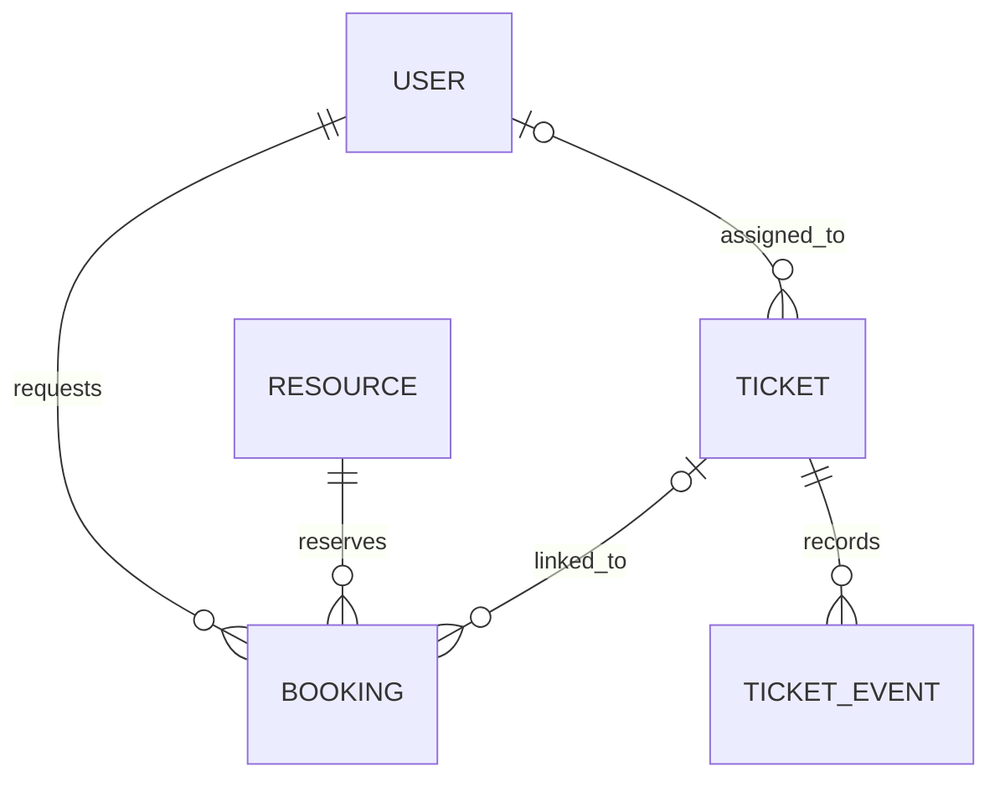

# TriageSync

## 1. Overview

TriageSync is a full-stack support ticket triage and shared-resource scheduling application. It helps support teams automatically categorize and prioritize incoming tickets, review classification decisions, preserve human overrides, and reserve rooms, laboratories and diagnostic equipment for troubleshooting sessions.

- **USER:** Import and review tickets, browse active resources, request bookings, track requests and cancel eligible own bookings.
- **ADMIN:** Access ticket workflows, manage resource inventory, review booking requests, approve or reject bookings and view administrative analytics.

## 2. Live links

| Service | URL |
| --- | --- |
| Deployed frontend | https://triagesync-bt2jbwta0-surajit-debnaths-projects.vercel.app/ |
| Deployed backend | https://engnf1-fullstack-surajit-debnath.onrender.com/ |
| Local frontend | http://localhost:5173 |
| Local API | http://localhost:3000/api |
| Local health endpoint | http://localhost:3000/api/health |

No deployed URLs are configured in the supplied source. Replace the TBD entries after deployment and update the frontend API configuration accordingly.

## 3. Seeded credentials

| Role | Name | Email | Password |
| --- | --- | --- | --- |
| ADMIN | Admin Lead | `admin@triagesync.test` | `Admin@123` |
| USER | Agent Demo | `user@triagesync.test` | `User@123` |

Public registration creates USER accounts only. The administrator is created by the seed script. These credentials are intended for development and assessment demonstrations; do not reuse them in production.

## 4. Tech stack

| Layer | Technologies |
| --- | --- |
| Frontend | React 19, TypeScript, Vite, Tailwind CSS 4, Lucide React |
| Routing and HTTP | React Router DOM, Axios |
| Backend | Node.js, Express 5, JavaScript (CommonJS) |
| Database | MongoDB, Mongoose |
| Authentication | JWT (24-hour expiry), bcryptjs (cost factor 10) |
| Validation | Zod |
| Development tooling | npm, Nodemon, ESLint, Prettier |
| Classification | Local rule-based ticket classifier |

## 5. Folder structure

```text
TriageSync/
├── README.md
├── SOLUTION.md
├── AI_USAGE.md
├── backend/
│   ├── .env.example
│   ├── package.json
│   ├── seeds/
│   │   └── seed.js
│   ├── tests/
│   │   └── booking-race.test.js
│   └── src/
│       ├── index.js
│       ├── controllers/
│       ├── middleware/
│       ├── models/
│       ├── routes/
│       ├── services/
│       ├── utils/
│       └── validation/
└── frontend/
    ├── package.json
    ├── vite.config.ts
    └── src/
        ├── App.tsx
        ├── config.ts
        ├── main.tsx
        ├── index.css
        ├── Pages/
        │   ├── LandingPage.tsx
        │   ├── Login.tsx
        │   ├── Register.tsx
        │   ├── Dashboard.tsx
        │   ├── Tickets.tsx
        │   ├── TicketDetails.tsx
        │   ├── TriageQueue.tsx
        │   ├── Resources.tsx
        │   ├── ResourceDetails.tsx
        │   ├── MyBookings.tsx
        │   ├── BookingDetails.tsx
        │   └── admin/
        │       ├── AdminDashboard.tsx
        │       ├── ManageResources.tsx
        │       └── ManageBookings.tsx
        ├── components/
        │   ├── auth/
        │   ├── bookings/
        │   ├── Dashboard/
        │   ├── LandingPage/
        │   ├── layouts/
        │   ├── resources/
        │   ├── tickets/
        │   └── ui/
        ├── services/
        └── types/
```

## 6. Local setup & idempotent seed command

### Prerequisites

- Node.js 22.12+ (or a compatible newer LTS release) and npm.
- MongoDB Atlas or a MongoDB replica set. Booking transactions require transaction-capable MongoDB; a standalone instance is insufficient.
- A local copy of this repository.

### Backend

From the repository root:

```bash
cd backend
npm ci
```

Create `backend/.env` using the following configuration (replace placeholders):

```env
PORT=3000
MONGODB_URL=your_mongodb_connection_string
JWT_AUTH_PASSWORD=your_long_random_secret
SALT_ROUND=10
```

Never commit real credentials, JWTs or database connection strings. `SALT_ROUND` is listed in the example configuration; current password hashing uses a hard-coded cost of 10.

### Database Seeding

Run the idempotent seed command to populate the database with the required demonstration data:

```bash
npm run seed
```

To delete all existing application records and restore the original demonstration dataset, run:

```bash
npm run seed:reset
```

**Warning:** The reset command permanently deletes existing users, resources, tickets, bookings and ticket audit events. Use it only for development, testing or resetting the demonstration database.

The fresh seed creates two users, six resources, 22 support tickets, three reviewed tickets and three corresponding audit events.

Check http://localhost:3000/api/health; the expected response is `{"message":"ok"}`.

### Frontend

In another terminal, from the repository root:

```bash
cd frontend
npm ci
```

Confirm `frontend/src/config.ts` contains:

```ts
export const BACKEND_URL = 'http://localhost:3000/api';
```

**Case-sensitive systems:** The supplied archive contains `src/Pages/`, while `App.tsx` imports `./pages/`. Rename the directory to `pages` (using an intermediate name if necessary) or update the imports before building on Linux.

```bash
npm run dev
```

Open http://localhost:5173 and sign in with a seeded account. For deployment, use the deployed API base URL including `/api`, and configure the static host to serve `index.html` for client-side routes.

### Idempotent seed

Run `npm run seed` from `backend/` whenever demo data is needed. The script uses stable identifiers and upserts:

- Two accounts matched by email; their names, roles and password hashes are refreshed on each run.
- Six resources (two rooms, two labs and two equipment resources, including inactive inventory), matched by case-insensitive name.
- 22 tickets matched by `externalId`, covering five categories and four priorities, including three reviewed tickets and an XSS test ticket.
- Review audit events matched by ticket ID, field, actor and new value.

Existing resource and ticket fields are preserved by `$setOnInsert`. Repeated sequential runs do not duplicate unchanged seed records. The seed does not create bookings or reset the database. Use a test database: rerunning the seed resets the seeded account passwords.

### Build and verification

From `frontend/`:

```bash
npm run lint
npx tsc -b
npm run build
```

From `backend/`, with the server running, add these optional test settings to `.env`:

```env
API_URL=http://localhost:3000
JWT_TOKEN=your_valid_user_jwt
RESOURCE_ID=your_active_resource_object_id
```

```bash
npm run test:booking-race
```

Use the server origin only for `API_URL`: the test appends `/api/bookings` itself, unlike the value in the supplied `.env.example`. The test sends ten concurrent requests for one future slot; the expected outcome is one HTTP 201 and nine HTTP 409 responses. Use an available slot and a user below the active-booking limit. Cancel the successful test booking before repeating the same slot. These are expected results, not verified test results.

## 7. DB schema

All models use MongoDB ObjectId primary keys (`_id`). References below are ObjectIds.

| Model | Fields | Constraints / indexes |
| --- | --- | --- |
| User | `name`, `email`, `passwordHash`, `role`, `bookingLockVersion`, `createdAt` | Unique lowercase email; USER/ADMIN; password hash and lock version excluded from normal queries |
| Ticket | `externalId`, `subject`, `body`, `autoCategory`, `category`, `priority`, `status`, `assigneeId`, `isReviewed`, `isHumanOverride`, `createdAt`, `updatedAt` | Unique externalId; indexes on (status, category), assigneeId and createdAt; nullable assignee references User |
| TicketEvent | `ticketId`, `field`, `oldValue`, `newValue`, `actor`, `createdAt` | References Ticket; index on (ticketId, createdAt); field limited to category, priority, status or assigneeId |
| Resource | `name`, `type`, `capacity`, `description`, `isActive`, `bookingLockVersion`, `createdAt` | Unique name; ROOM/LAB/EQUIPMENT; capacity 1–500 at API validation; active by default |
| Booking | `resourceId`, `userId`, `ticketId`, `startTime`, `endTime`, `purpose`, `status`, `decisionNote`, `createdAt` | References Resource, User and optional Ticket; compound index on (resourceId, startTime, endTime); PENDING by default |



**Enumerations**

- Ticket categories: `BILLING`, `BUG`, `FEATURE_REQUEST`, `LOGIN`, `DELIVERY`.
- Ticket priorities: `LOW`, `MEDIUM`, `HIGH`, `URGENT`.
- Ticket statuses: `OPEN`, `IN_PROGRESS`, `RESOLVED`, `CLOSED`.
- Booking statuses: `PENDING`, `APPROVED`, `REJECTED`, `CANCELLED`.

**Business rules**

A ticket becomes reviewed when its category actually changes or its status transitions away from OPEN. Priority or assignee changes alone do not count. Category changes activate human override; both flags remain set once activated. Re-imports preserve overridden classification and priority while allowing subject/body updates. Non-overridden tickets can be reclassified on import.

Bookings use UTC ISO timestamps aligned to 30-minute boundaries, durations of 30–240 minutes, a future start within 30 days, and a maximum of three future PENDING/APPROVED bookings per user. PENDING and APPROVED intervals block overlapping bookings on the same resource. MongoDB transactions and resource/user lock-version updates are used to protect these constraints under concurrency.

## 8. API summary

Base URL: `/api`. Protected requests use the custom `token` header containing the JWT, not an Authorization Bearer header. JSON requests use `Content-Type: application/json`.

| Method | Endpoint (relative to /api) | Access | Description |
| --- | --- | --- | --- |
| GET | `/health` | Public | Health check |
| POST | `/auth/register` | Public | Register USER |
| POST | `/auth/login` | Public | Authenticate and obtain JWT |
| GET | `/auth/me` | Authenticated | Current user |
| POST | `/tickets/import` | Authenticated | Import `{ tickets: [...] }` |
| GET | `/tickets` | Authenticated | Search/filter/paginate tickets (`q`, `category`, `priority`, `status`, `page`, `limit`) |
| GET | `/tickets/:id` | Authenticated | Ticket and audit events |
| PATCH | `/tickets/:id` | Authenticated | Update category, priority, status or assigneeId; send `X-Agent` header |
| GET | `/stats` | Authenticated | Ticket counts, reviewed count and model agreement rate |
| GET | `/resources` | Authenticated | Filter by `search`, `type`, `minCapacity`, `page`; USER sees active resources only |
| GET | `/resources/:id` | Authenticated | Resource details subject to role visibility |
| GET | `/resources/:id/availability` | Authenticated | Occupied intervals for `from` and `to` (UTC ISO, maximum seven days) |
| POST | `/resources` | ADMIN | Create resource |
| PATCH | `/resources/:id` | ADMIN | Update name, type, capacity or description |
| POST | `/bookings` | Authenticated | Create PENDING booking |
| GET | `/bookings/mine` | Authenticated | Own bookings (`status`, `page`) |
| GET | `/bookings` | ADMIN | All bookings (`status`, `resourceId`, `from`, `to`, `page`) |
| GET | `/bookings/:id` | Owner or ADMIN | Booking details |
| PATCH | `/bookings/:id/cancel` | Owner | Cancel future PENDING or APPROVED booking |
| PATCH | `/bookings/:id/approve` | ADMIN | Approve future PENDING booking |
| PATCH | `/bookings/:id/reject` | ADMIN | Reject future PENDING booking with `{ "note": "reason" }` |
| GET | `/admin/stats` | ADMIN | Active resources, booking counts, top resources and ticket analytics |

Resource and booking list endpoints use a fixed page size of 10. Admin booking date filters require both `from` and `to` and return overlapping intervals. The frontend converts inclusive local calendar dates into UTC boundaries.

## 9. Completed features checklist

The checked items below indicate implementation present in the supplied source, not independently verified runtime acceptance tests.

- [x] Registration, login, logout and role-based dashboard routing.
- [x] JSON ticket import, automatic categorization and prioritization.
- [x] Duplicate prevention using unique external ticket IDs.
- [x] Ticket search, filters, pagination and details.
- [x] Triage queue and manual review with human-override protection.
- [x] Field-change audit event creation and audit trail display.
- [x] React text rendering for ticket content and seeded XSS test data.
- [x] User and administrator dashboard analytics.
- [x] Administrator resource creation and editing.
- [x] Resource browsing, filtering and availability calendar.
- [x] Booking creation with optional linked ticket.
- [x] Booking duration, advance-window and active-booking validation.
- [x] Transaction-based booking overlap protection and concurrency test script.
- [x] My Bookings and administrator Manage Bookings pages.
- [x] Booking details, approval, rejection with reason and owner cancellation.
- [x] Idempotent demo-data seed script.
- [ ] Verify production build, lint and TypeScript checks.
- [ ] Execute end-to-end acceptance and concurrency tests.
- [ ] Deploy frontend/backend and supply live URLs.

## 10. Known limitations

- **Deployment:** The API URL is hard-coded to localhost; deployed URLs are not supplied. The Pages/pages mismatch must be resolved on case-sensitive hosts.
- **Authentication hardening:** JWT middleware does not explicitly catch invalid or expired token verification errors. Tokens are stored in localStorage, and CORS is unrestricted. Production deployment needs stronger token handling, restricted origins and HTTPS.
- **Audit integrity:** Ticket events are append-only through the exposed API, but are not database-enforced immutable records. Ticket updates and audit inserts are separate writes, so they are not atomic. Re-import classification changes do not generate equivalent review audit events. The actor is taken from the client-controlled `X-Agent` header; the fallback references `req.user.email`, which the current middleware does not populate.
- **Classification:** Classification is rule-based rather than a trained ML model. Non-overridden tickets can be reclassified on re-import, including their `autoCategory` value.
- **Resource administration:** No delete or activation/deactivation endpoint is exposed. The frontend calendar displays a 09:00–18:00 local-time window; this is a UI convention, not a backend business-hours restriction.
- **Booking lifecycle:** No automatic expiry/completion state, recurring bookings, waitlist or notification workflow is implemented. Past pending requests retain their stored status. Bookings return reference IDs rather than populated user/resource objects.
- **Scalability:** Admin resource filters load all resource pages; user booking cards resolve resource details separately. User booking summaries use multiple list requests rather than a dedicated summary endpoint.
- **Testing:** The race test uses one user for ten concurrent requests and requires a transaction-capable database. Multi-user contention, failure recovery and full end-to-end behavior still need runtime verification. The example race-test API URL must be corrected as described in section 6.
